# Web UI for monitoring & administering [Asynq](https://github.com/hibiken/asynq) task queue

## Overview

Asynqmon is a web UI tool for monitoring and administering [Asynq](https://github.com/hibiken/asynq) queues and tasks.
It supports integration with [Prometheus](https://prometheus.io) to display time-series data.

Asynqmon is both a library that you can include in your web application, as well as a binary that you can simply install and run.

## Version Compatibility

Please make sure the version compatibility with the Asynq package you are using.

| Asynq version  | WebUI (asynqmon) version |
| -------------- | ------------------------ |
| 0.23.x         | 0.7.x                    |
| 0.22.x         | 0.6.x                    |
| 0.20.x, 0.21.x | 0.5.x                    |
| 0.19.x         | 0.4.x                    |
| 0.18.x         | 0.2.x, 0.3.x             |
| 0.16.x, 0.17.x | 0.1.x                    |

## Install the binary

There're a few options to install the binary:

- [Download a release binary](#release-binaries)
- [Download a docker image](#docker-image)
- [Build a binary from source](building-from-source)
- [Build a docker image from source](#building-docker-image-locally)

### Release binaries

You can download the release binary for your system from the [releases page](https://github.com/hibiken/asynqmon/releases).

### Docker image

To pull the Docker image:

```bash
# Pull the latest image
docker pull hibiken/asynqmon

# Or specify the image by tag
docker pull hibiken/asynqmon[:tag]
```

### Building from source

To build Asynqmon from source code, make sure you have Go installed ([download](https://golang.org/dl/)). Version `1.27` or higher is required. You also need [Node.js](https://nodejs.org/) 22.18 or higher (with npm; the version Vite+ requires) in order to build the frontend assets.

Download the source code of this repository and then run:

```bash
make build
```

The `asynqmon` binary should be created in the current directory. `make build` builds the web UI first (`make assets`:
`npm ci` and `npm run build` in `ui/`) into `ui/build`, which the Go binary embeds.

### Building Docker image locally

To build Docker image locally, run:

```bash
make docker
```

## Run the binary

To use the defaults, simply run and open http://localhost:8080.

```bash
# with a binary
./asynqmon

# with a docker image
docker run --rm \
    --name asynqmon \
    -p 8080:8080 \
    hibiken/asynqmon
```

By default, Asynqmon web server listens on port `8080` and connects to a Redis server running on `127.0.0.1:6379`.

To see all available flags, run:

```bash
# with a binary
./asynqmon --help

# with a docker image
docker run hibiken/asynqmon --help
```

Here's the available flags:

_Note_: Use `--redis-url` to specify address, db-number, and password with one flag value; Alternatively, use `--redis-addr`, `--redis-db`, and `--redis-password` to specify each value.

| Flag                              | Env                       | Description                                                                                                                  | Default          |
| --------------------------------- | ------------------------- | ---------------------------------------------------------------------------------------------------------------------------- | ---------------- |
| `--port`(int)                     | `PORT`                    | port number to use for web ui server                                                                                         | 8080             |
| `---redis-url`(string)            | `REDIS_URL`               | URL to redis or sentinel server. See [godoc](https://pkg.go.dev/github.com/hibiken/asynq#ParseRedisURI) for supported format | ""               |
| `--redis-addr`(string)            | `REDIS_ADDR`              | address of redis server to connect to                                                                                        | "127.0.0.1:6379" |
| `--redis-db`(int)                 | `REDIS_DB`                | redis database number                                                                                                        | 0                |
| `--redis-password`(string)        | `REDIS_PASSWORD`          | password to use when connecting to redis server                                                                              | ""               |
| `--redis-cluster-nodes`(string)   | `REDIS_CLUSTER_NODES`     | comma separated list of host:port addresses of cluster nodes                                                                 | ""               |
| `--redis-tls`(string)             | `REDIS_TLS`               | server name for TLS validation used when connecting to redis server                                                          | ""               |
| `--redis-insecure-tls`(bool)      | `REDIS_INSECURE_TLS`      | disable TLS certificate host checks                                                                                          | false            |
| `--enable-metrics-exporter`(bool) | `ENABLE_METRICS_EXPORTER` | enable prometheus metrics exporter to expose queue metrics                                                                   | false            |
| `--prometheus-addr`(string)       | `PROMETHEUS_ADDR`         | address of prometheus server to query time series                                                                            | ""               |
| `--read-only`(bool)               | `READ_ONLY`               | use web UI in read-only mode                                                                                                 | false            |

### Connecting to Redis

To connect to a **single redis server**, use either `--redis-url` or (`--redis-addr`, `--redis-db`, and `--redis-password`).

Example:

```sh
$ ./asynqmon --redis-url=redis://:mypassword@localhost:6380/2

$ ./asynqmon --redis-addr=localhost:6380 --redis-db=2 --redis-password=mypassword
```

To connect to **redis-sentinels**, use `--redis-url`.

Example:

```sh
$ ./asynqmon --redis-url=redis-sentinel://:mypassword@localhost:5000,localhost:5001,localhost:5002?master=mymaster
```

To connect to a **redis-cluster**, use `--redis-cluster-nodes`.

Example:

```sh
$ ./asynqmon --redis-cluster-nodes=localhost:7000,localhost:7001,localhost:7002,localhost:7003,localhost:7004,localhost:7006
```

### Integration with Prometheus

The binary supports two flags to enable integration with [Prometheus](https://prometheus.io/).

First, enable metrics exporter to expose queue metrics to Prometheus server by passing `--enable-metrics-exporter` flag.
The metrics data is now available under `/metrics` for Prometheus server to scrape.

Once the metrics data is collected by a Prometheus server, you can pass the address of the Prometheus server to asynqmon to query the time-series data.
The address can be specified via `--prometheus-addr`. This enables the metrics view on the Web UI.

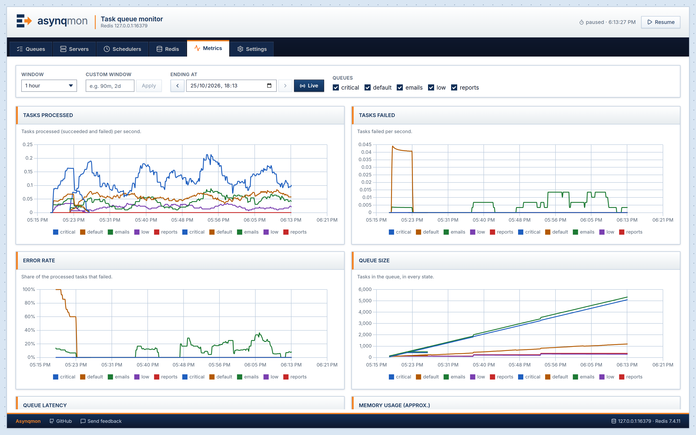

### Examples

```bash
# with a local binary; custom port and connect to redis server at localhost:6380
./asynqmon --port=3000 --redis-addr=localhost:6380

# with prometheus integration enabled
./asynqmon --enable-metrics-exporter --prometheus-addr=http://localhost:9090

# with Docker (connect to a Redis server running on the host machine)
docker run --rm \
    --name asynqmon \
    -p 3000:3000 \
    hibiken/asynqmon --port=3000 --redis-addr=host.docker.internal:6380

# with Docker (connect to a Redis server running in the Docker container)
docker run --rm \
    --name asynqmon \
    --network dev-network \
    -p 8080:8080 \
    hibiken/asynqmon --redis-addr=dev-redis:6379
```

Next, go to [localhost:8080](http://localhost:8080) and see Asynqmon dashboard:

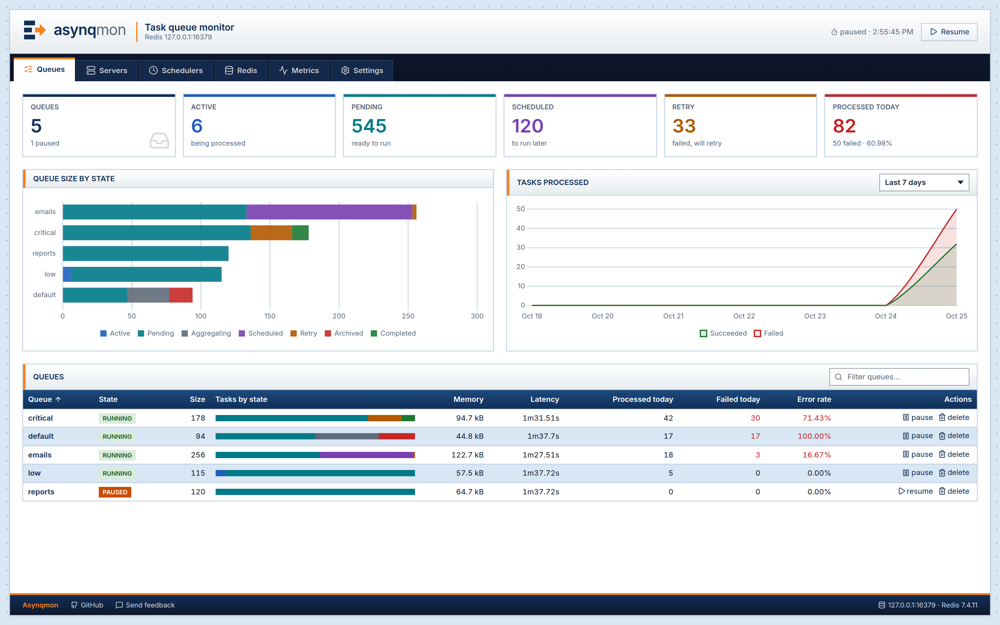

**Queue view**: a tab per task state with its count, payloads and results in a viewer, row actions and bulk
actions on a selection or on every task of the state, each destructive one behind a confirmation.

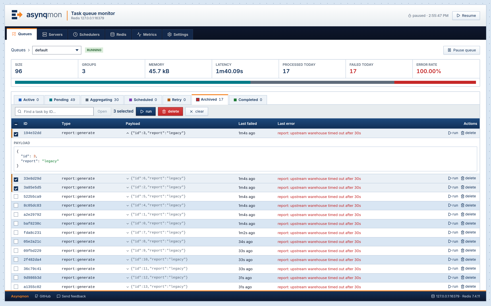

**Task details**

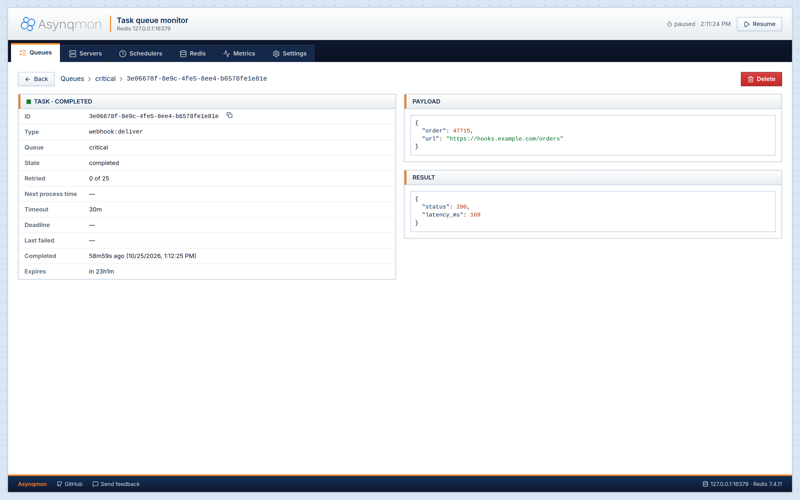

**Servers**, **Schedulers** and **Redis**

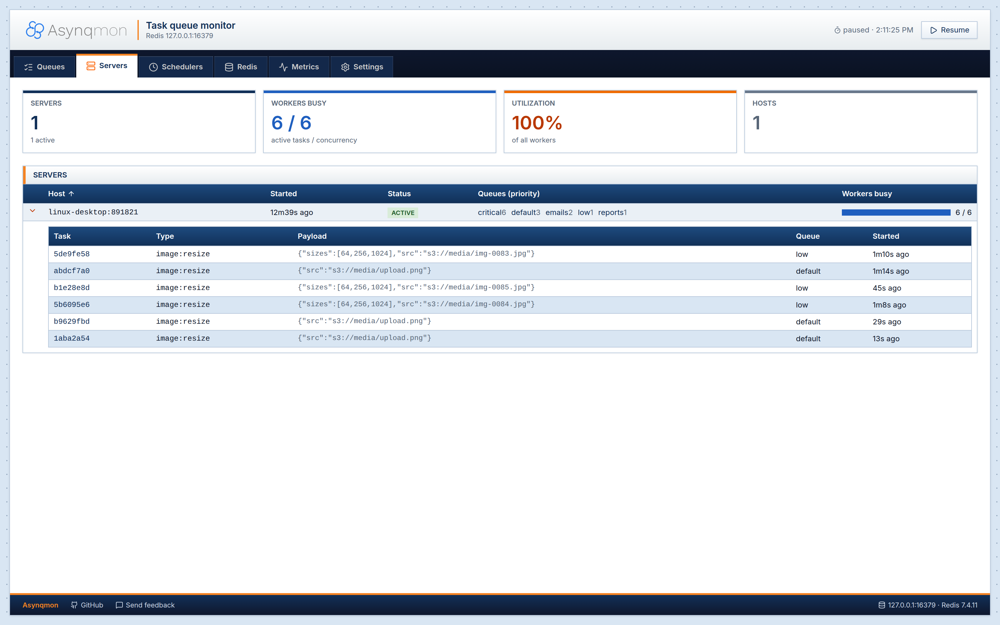

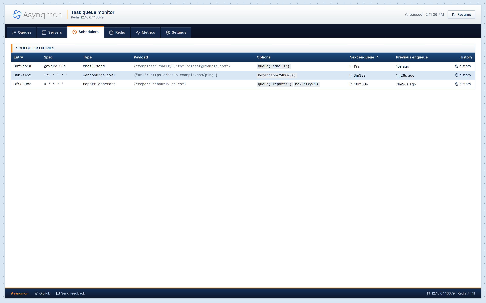

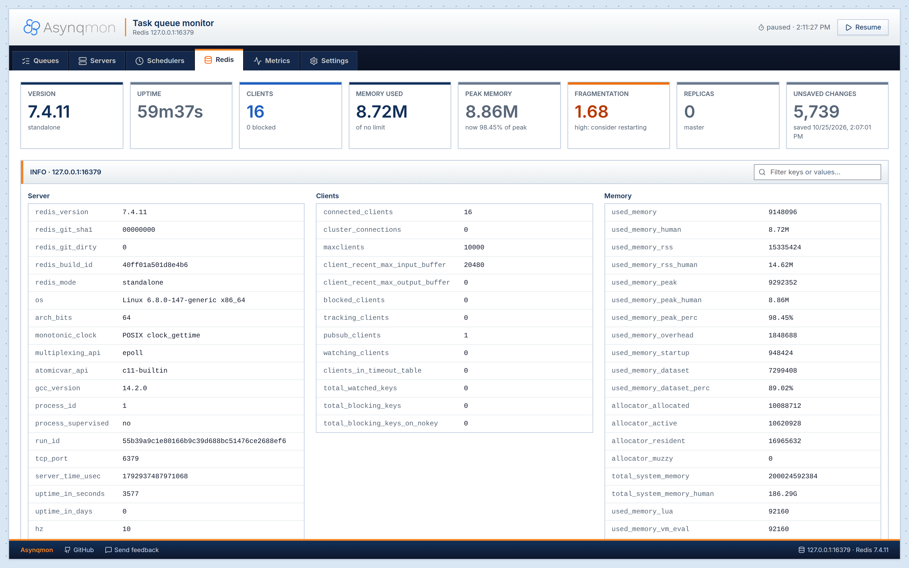

### Themes

The web UI comes with 20 themes (Settings → Theme, kept in the browser), with square corners and an optional flat
look: Default, Classic blue (XP), Classic gray (98), Graphite, Breeze, Violet, Aurora, Crystal, Cone, Matrix, Winamp,
Pink Panther, High contrast and others, plus **Grafana** (dark, the Grafana 11 look) and **RabbitMQ** (the RabbitMQ
management UI look). "Automatic" follows the system: Default on a light system, Grafana on a dark one. Every theme
passes WCAG AA contrast (Classic blue, Crystal and High contrast AAA), checked by the UI unit tests.

| Grafana | RabbitMQ |
| --- | --- |
| 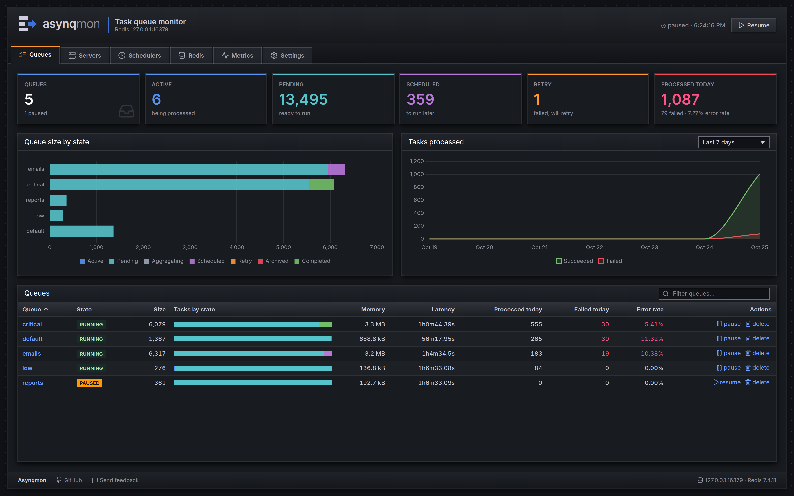 | 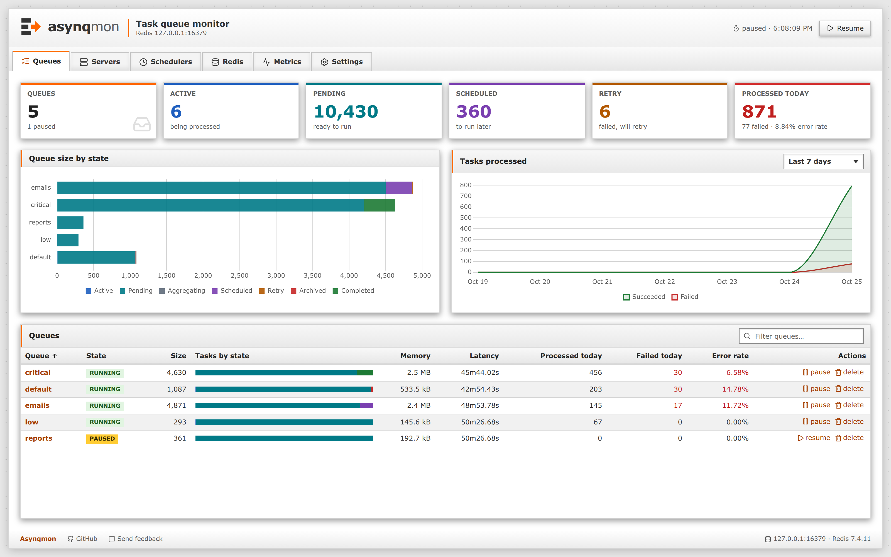 |
| 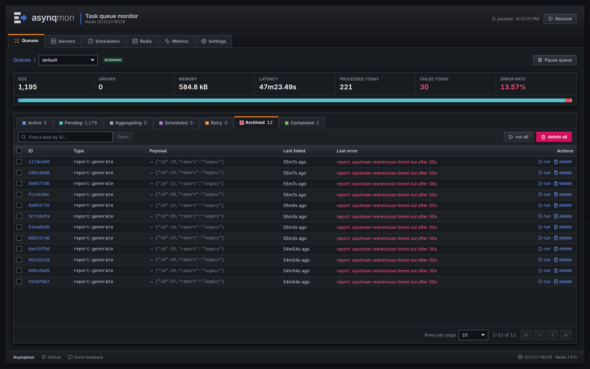 | 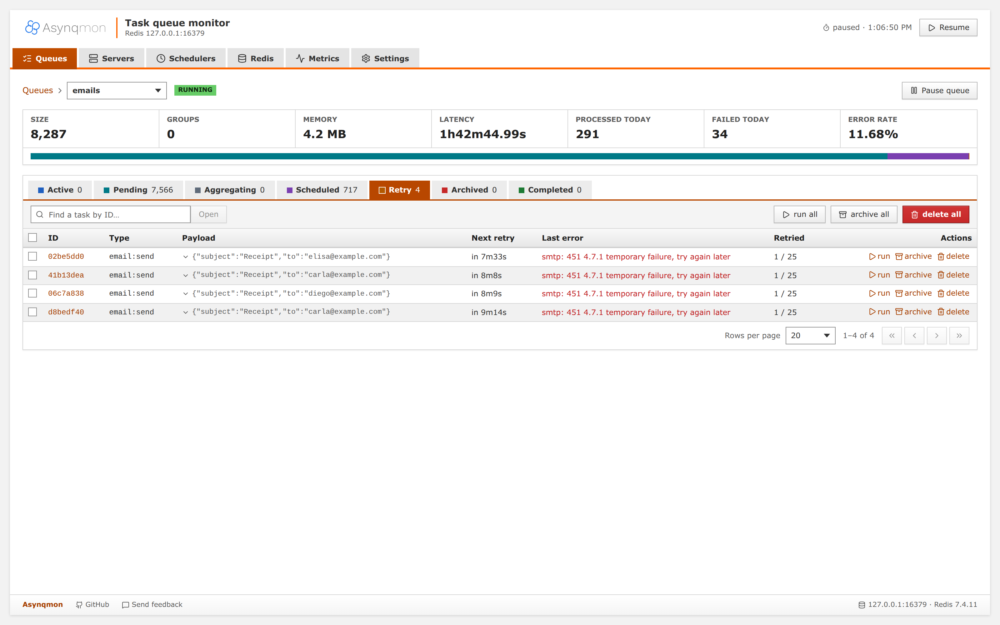 |

| Classic blue (XP) | Graphite |
| --- | --- |
| 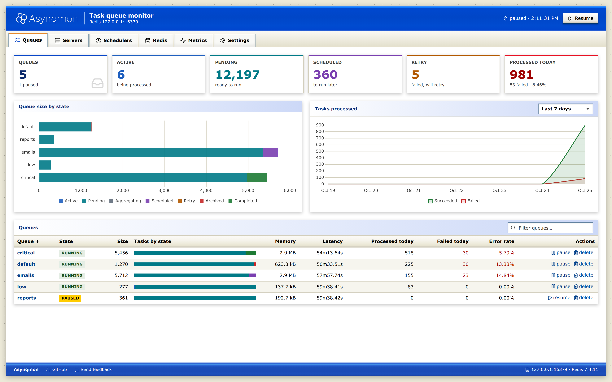 | 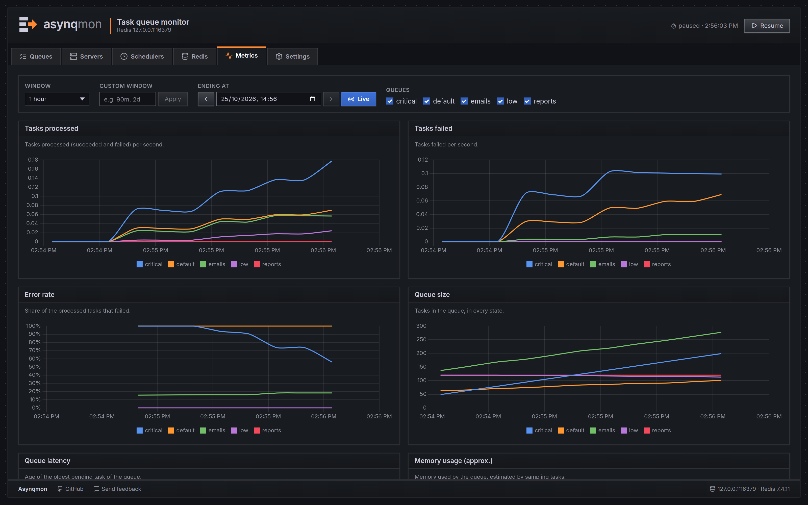 |

### Developing the UI

The UI lives in `ui/` (Vue 3, [Vite+](https://viteplus.dev) and Tailwind CSS 4; the themes are CSS files of role
tokens in `ui/src/themes/`, registered in `ui/src/themes/registry.js`, with the contrast matrix in
`ui/src/themes/matrix.json`). With a throwaway Redis filled with sample tasks:

```bash
docker run -d --name asynqmon-redis -p 6379:6379 redis:7-alpine
make seed &                       # asynq server, scheduler and producer with tasks in every state
make api && ./api &               # the API on :8080 (no UI build needed)
cd ui && npm ci && npm run dev    # the UI on http://localhost:3000, /api proxied to :8080
```

`make ui-check` formats, lints and runs the unit tests (formatting helpers and the theme contrast matrix).
`npm run screenshots` (in `ui/`, `ASYNQMON_URL` pointing at a running asynqmon) retakes `docs/screenshots` at 2× and
fails on any console error or failed request.

## Import as a Library

[](https://godoc.org/github.com/hibiken/asynqmon)

Asynqmon is also a library which can be imported into an existing web application.

Example with [net/http](https://pkg.go.dev/net/http):

```go
package main

import (
	"log"
	"net/http"

	"github.com/hibiken/asynq"
	"github.com/hibiken/asynqmon"
)

func main() {
	h := asynqmon.New(asynqmon.Options{
		RootPath: "/monitoring", // RootPath specifies the root for asynqmon app
		RedisConnOpt: asynq.RedisClientOpt{Addr: ":6379"},
	})

    // Note: We need the tailing slash when using net/http.ServeMux.
	http.Handle(h.RootPath()+"/", h)

	// Go to http://localhost:8080/monitoring to see asynqmon homepage.
	log.Fatal(http.ListenAndServe(":8080", nil))
}
```

Example with [gorilla/mux](https://pkg.go.dev/github.com/gorilla/mux):

```go
package main

import (
	"log"
	"net/http"

	"github.com/gorilla/mux"
	"github.com/hibiken/asynq"
	"github.com/hibiken/asynqmon"
)

func main() {
	h := asynqmon.New(asynqmon.Options{
		RootPath: "/monitoring", // RootPath specifies the root for asynqmon app
		RedisConnOpt: asynq.RedisClientOpt{Addr: ":6379"},
	})

	r := mux.NewRouter()
	r.PathPrefix(h.RootPath()).Handler(h)

	srv := &http.Server{
		Handler: r,
		Addr:    ":8080",
	}

	// Go to http://localhost:8080/monitoring to see asynqmon homepage.
	log.Fatal(srv.ListenAndServe())
}
```

Example with [labstack/echo](https://github.com/labstack/echo)):


```go
package main

import (
	"github.com/labstack/echo/v4"
	"github.com/hibiken/asynq"
	"github.com/hibiken/asynqmon"
)

func main() {
        e := echo.New()

	mon := asynqmon.New(asynqmon.Options{
		RootPath: "/monitoring/tasks",
		RedisConnOpt: asynq.RedisClientOpt{
			Addr: ":6379",
			Password: "",
			DB: 0,
		},
	})
	e.Any("/monitoring/tasks/*", echo.WrapHandler(mon))
	e.Start(":8080")
}
```


## License

Copyright (c) 2019-present [Ken Hibino](https://github.com/hibiken) and [Contributors](https://github.com/hibiken/asynqmon/graphs/contributors). `Asynqmon` is free and open-source software licensed under the [MIT License](https://github.com/hibiken/asynq/blob/master/LICENSE). Official logo was created by [Vic Shóstak](https://github.com/koddr) and distributed under [Creative Commons](https://creativecommons.org/publicdomain/zero/1.0/) license (CC0 1.0 Universal).
